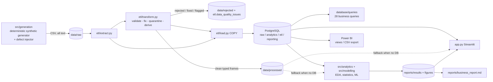

# Architecture

## Layers and why
| Layer | Purpose | Decision |
|---|---|---|
| `raw` schema | Exact copy of the extract, every column TEXT | A bad value can never block a load or vanish; lineage via `_src_row` |
| `etl` schema | Audit trail of every rule outcome | "Never silently discard": CHECK `raw_rows = clean_rows + rejected_rows` |
| `analytics` schema | Typed, constrained, FK-enforced + derived columns | The only layer analysts, the app and Power BI should read |
| `reporting` schema | Flat views (one row per loan etc.) | Keeps DAX simple and KPI logic in one place |

## Key technical decisions
1. **Raw as TEXT, typed in Python.** Strict parsing (ISO dates, numeric coercion) happens in `etl/transform.py`, where every failure is logged with a reason.
2. **Rules are evaluated independently** on every row so a bad row is never masked by another rule; counts of "rows rejected" use distinct source rows.
3. **Cascade vs orphan.** A child row whose parent was *rejected* is logged separately (`...b` rules) from a true orphan, so you can tell source defects from knock-on effects.
4. **Fixed vs rejected.** Recoverable fields (age, credit score, employment label) are nulled/standardised and flagged; structurally broken rows (negative amounts, invalid keys, inconsistent status) are quarantined. Missing income stays NULL - not imputed in the warehouse; modelling imputes inside a pipeline fitted on training data only.
5. **Mature-loan default rate.** Avoids right-censoring bias.
6. **Out-of-time model validation** and an explicit forbidden-feature list (`src/modelling/features.py`) enforced by a test.
7. **Python and SQL cross-checked.** Tests recompute key SQL results in pandas.
8. **No extra frameworks.** Streamlit + Plotly were added only for the app, at the user's request; everything else is the specified stack.

## Reproducibility
All randomness uses `numpy.random.default_rng(seed)` (seed 42). Same seed -> identical files (tested). Credentials are read from environment variables / `.env` / Streamlit secrets and never committed.
